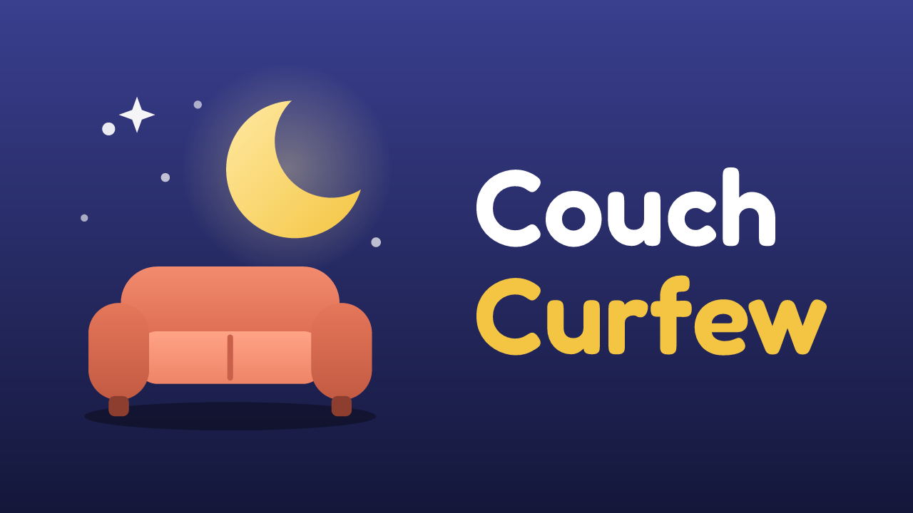
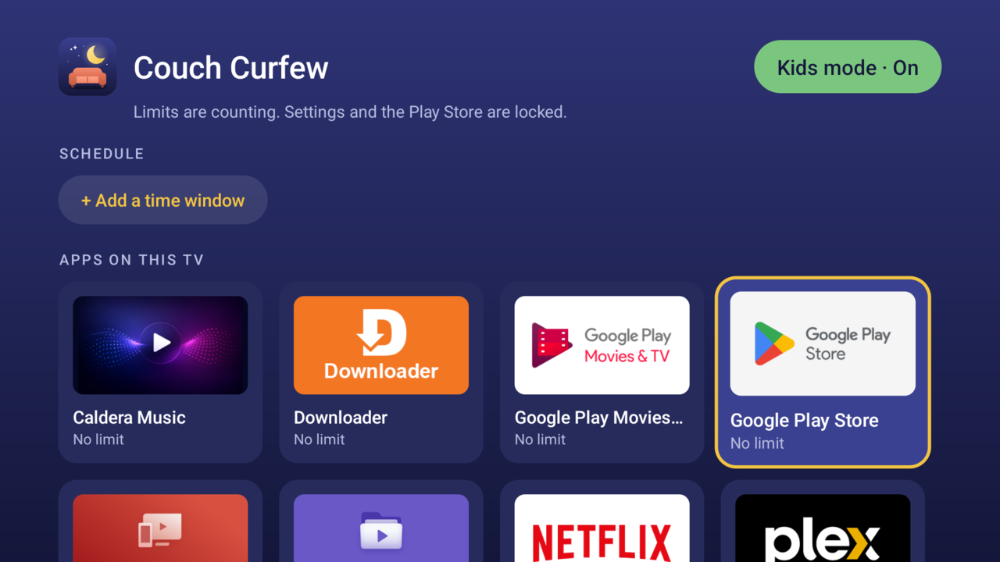

<p align="center">
  
</p>

<p align="center">
  <b>Daily time limits and a kids mode for Android TVs running <a href="https://github.com/simbasjungles/free-my-tv">Free My TV</a>.</b>
</p>

<p align="center">
  <a href="https://github.com/juanra/couch-curfew/releases/latest"></a>
  
  <a href="LICENSE"></a>
  <a href="https://github.com/sponsors/juanra"></a>
</p>

---

## Contents

- [Why](#why)
- [Features](#features)
- [Screenshots](#screenshots)
- [Install](#install)
- [How it works](#how-it-works)
- [Limits](#limits-read-this)
- [Recovery](#recovery)
- [Languages](#languages)
- [Build from source](#build-from-source)
- [Roadmap](#roadmap)
- [Support](#support)
- [License](#license)

## Why

[Free My TV](https://github.com/simbasjungles/free-my-tv) replaces an Android TV's ad-filled home screen with a clean
one. A family TV also needs something else: "YouTube, 60 minutes a day" while the kids are watching, and no limits
when the grown-ups are. Free My TV's author chose to keep it a home screen and
[suggested parental controls live as a project of their own](https://github.com/simbasjungles/free-my-tv/pull/153).
This is that project.

Couch Curfew is an **unofficial companion** to Free My TV, not part of it.

## Features

- **Kids mode, behind a parent PIN.** Limits only count while kids mode is on, so grown-ups watch without a timer. The
  PIN is typed on an on-screen keypad with the remote.
- **A schedule for kids mode.** Windows of days and hours ("Mon–Fri 14:00–20:00", "Sat–Sun 08:00–21:00", even
  "20:00–07:00" across midnight) turn it on and off by themselves. A parent can still switch it by hand; that holds
  until the schedule's next start or end.
- **A daily limit per app**: 15 minutes to 3 hours, no limit, or **not allowed** in kids mode. Time resets at midnight.
- **When time is up** the app closes, the TV goes home and the app stays paused until midnight. One minute before, a
  warning shows. Opening a paused app explains why, and tells the kid to ask their parents.
- **+30 minutes today** for one app, without changing its limit.
- **Settings is locked in kids mode**, so the limits can't be switched off from the TV's menus. The Play Store too:
  Android refuses to pause it, so Couch Curfew sends the TV home whenever it opens.
- **Private by design.** Everything is set up on the TV, behind the PIN. No account, no cloud, no tracking: the only
  network use is the TV's own ADB on `127.0.0.1`.

## Screenshots



## Install

You need an Android TV (8.0 or newer) on the same network as a computer with
[adb](https://developer.android.com/tools/releases/platform-tools). Free My TV is recommended, not required.

1. On the TV, turn on **Developer options → Network debugging**. If you set up Free My TV, this is already on.
2. Download `CouchCurfew.apk` from the [latest release](https://github.com/juanra/couch-curfew/releases/latest) and
   install it:
   ```sh
   adb connect <tv-ip>:5555
   adb install -r CouchCurfew.apk
   ```
3. Open **Couch Curfew** from the TV's apps and create the parent PIN.
4. Pick **Setup**. The TV asks once to allow USB debugging for Couch Curfew: check **Always allow** and accept.
5. Pick a limit for each app you want to limit, then turn **Kids mode** on, or add a **Schedule** window.

On TCL and other TVs that kill background apps, Setup also grants `APP_AUTO_START`, so the midnight reset, the
schedule and the restore after a reboot can run.

## How it works

Like Free My TV, Couch Curfew talks to the TV's own ADB (network debugging, `127.0.0.1:5555`) to run a few fixed
commands: `pm suspend` and `pm unsuspend` on the apps that must be blocked, `am force-stop` on an app that ran out of
time, and turning its accessibility service on. The accessibility service only receives window changes (which app is
in front); it never reads the screen. One alarm wakes it at midnight and at each start or end of a schedule window.

The ADB client is adapted from Free My TV's, under its MIT license.

## Limits (read this)

Couch Curfew is a speed bump for young kids, not a lock for a determined teenager. It can't stop:

- **HDMI devices** (a console, a streaming stick): they don't go through the TV's apps.
- **A factory reset**, or turning off network debugging from Developer options before kids mode is on.
- **Free My TV's own settings**, since Free My TV is the home screen. They don't switch Couch Curfew off.
- **Anything during the first seconds** after the TV boots, before the service starts.

## Recovery

Forgot the PIN? From a computer: `adb shell pm clear cc.nunez.couchcurfew` (this also clears the limits). If the app
is removed while apps are paused, resume them with `adb shell pm unsuspend <package>`; Settings is
`com.android.tv.settings` on most Android TVs.

## Languages

English, Spanish, Portuguese (Brazil), French, German, Italian and Russian, following the TV's language. Only English
and Spanish were written by a native speaker; the others are a first pass, and corrections are welcome as pull
requests to `app/res/values-*/strings.xml`.

## Build from source

Needs a JDK 17+ and the Android SDK command-line tools (build-tools 34+, platform android-34). No Gradle.

```sh
./test.sh    # the time, PIN and schedule rules, on your computer
./build.sh   # CouchCurfew.apk, signed with couchcurfew.keystore (created on the first build)
```

Keep `couchcurfew.keystore`: updates must be signed with the same key. An APK you build yourself is signed with your
own key, so it can't update one installed from a release (uninstall that one first).

## Roadmap

- Bedtime: every app locked during a window.
- A combined daily total across apps.
- HDMI inputs.

## Support

Bugs and ideas: [GitHub Issues](https://github.com/juanra/couch-curfew/issues).

If Couch Curfew helps at home, consider sponsoring its development:

[](https://github.com/sponsors/juanra)

## License

MIT. See [LICENSE](LICENSE). Not affiliated with Free My TV or its author.
