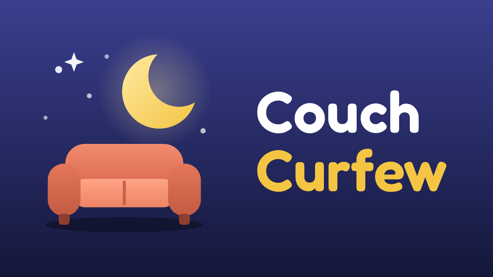
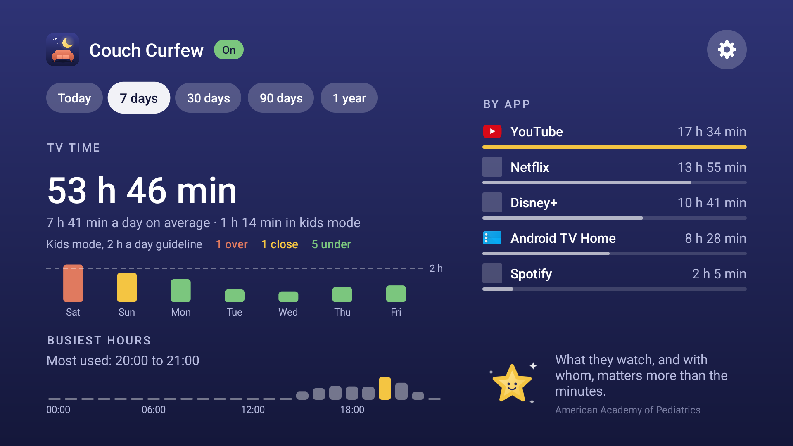
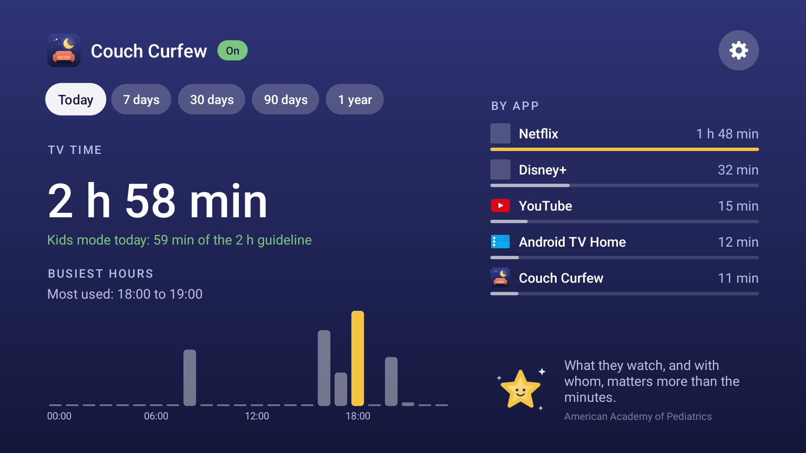
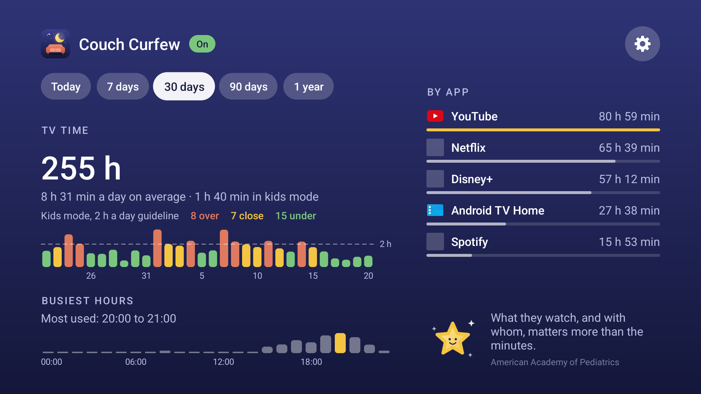
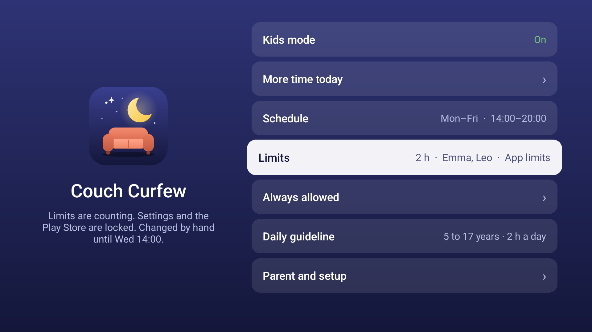
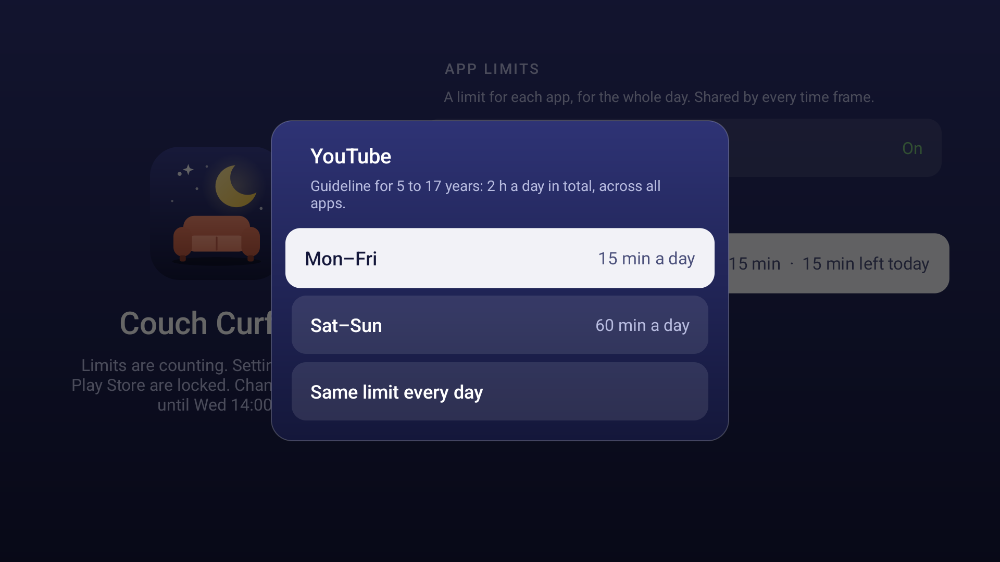

<p align="center">
  
</p>

<p align="center">
  <b>Daily time limits, a kids mode and a usage dashboard for Android TV and Google TV.</b>
</p>

<p align="center">
  <a href="https://github.com/juanra/couch-curfew/releases/latest"></a>
  
  <a href="LICENSE"></a>
  <a href="https://github.com/sponsors/juanra"></a>
</p>

---

## Contents

- [Why](#why)
- [Features](#features)
- [Screenshots](#screenshots)
- [Install](#install)
- [User guide](#user-guide)
- [How it works](#how-it-works)
- [The daily guideline](#the-daily-guideline)
- [Limits](#limits-read-this)
- [Recovery](#recovery)
- [Languages](#languages)
- [Build from source](#build-from-source)
- [Roadmap](#roadmap)
- [Support](#support)
- [License](#license)

## Why

A family TV needs "YouTube, 60 minutes a day" while the kids are watching, and no limits when the grown-ups are.
Android TV has no such thing built in, and the parental controls that exist want an account, a phone app or a cloud.
Couch Curfew does it on the TV itself, with the remote.

It is a standalone app: it needs no particular home screen. It goes well with the projects that clean up an Android
TV, such as [Free My TV](https://github.com/simbasjungles/free-my-tv) or
[CleanMyTV](https://github.com/wingedpanther/cleanmytv): they take the ads and the bloat away, Couch Curfew adds the
time limits. It started when Free My TV's author
[suggested parental controls live as a project of their own](https://github.com/simbasjungles/free-my-tv/pull/153).
It is not part of, or affiliated with, any of them, and has only been tested next to Free My TV.

## Features

- **A dashboard, open to everyone.** The app opens on a year of history: how long the TV was on, which apps took that
  time and at what hours, for today, the last 7, 30 or 90 days or the last year. All apps are recorded, in kids mode
  or not. Seeing it needs no PIN; changing anything does.
- **A daily guideline for the kids' age.** Pick the youngest child's age and the days turn green, yellow or red:
  under, close to (from 80%) or over the recommended daily screen time, counting only the time in kids mode. A dashed
  line marks the guideline and a count ("1 over, 1 close, 5 under") says what the colors say. See
  [The daily guideline](#the-daily-guideline).
- **One thing a parent can do, every day.** Under the apps, a short tip with its source and a small drawing: watch
  together, no screens at meals, turn autoplay off.
- **Kids mode, behind a parent PIN.** Limits only count while kids mode is on, so grown-ups watch without a timer. The
  PIN is typed on an on-screen keypad with the remote.
- **A schedule for kids mode.** Windows of days and hours ("Mon–Fri 14:00–20:00", "Sat–Sun 08:00–21:00", even
  "20:00–07:00" across midnight) turn it on and off by themselves. A parent can still switch it by hand; that holds
  until the schedule's next start or end.
- **A daily limit per app**: 15 minutes to 3 hours, no limit, or **not allowed** in kids mode. Time resets at midnight.
- **Different limits on weekends.** Each app can have one limit for Monday to Friday and another for Saturday and
  Sunday: "YouTube, 15 minutes on school days, an hour on weekends", or not allowed during the week at all.
- **A morning total for school days.** From Monday to Friday, until a time the parent picks (13:00 by default), every
  app with a limit can share one total of 10 to 60 minutes. What the youngest watches while the others are at school
  comes out of that total, and each app starts the afternoon with its whole limit. Off by default.
- **When time is up** the app closes, the TV goes home and the app stays paused until midnight. One minute before, a
  warning shows. Opening a paused app explains why, and tells the kid to ask their parents.
- **+30 minutes today** for one app, without changing its limit.
- **Settings and the Play Store are locked in kids mode**, so the limits can't be switched off from the TV's menus:
  opening either one sends the TV home.
- **Private by design.** Everything is set up on the TV, behind the PIN, and the usage history stays in the app's own
  database on the TV. No account, no cloud, no tracking: the only network use is the TV's own ADB on `127.0.0.1`.

## Screenshots

The last 7 days against the guideline, with the day over it in red:



| Today | 30 days |
|---|---|
|  |  |

| Limits and settings | A limit for weekdays and another for weekends |
|---|---|
|  |  |

The screenshots come from an emulator with sample data.

## Install

You need an Android TV (8.0 or newer) on the same network as a computer with
[adb](https://developer.android.com/tools/releases/platform-tools). No other app is required.

1. On the TV, turn on **Developer options → Network debugging**. If you set up the TV with Free My TV or a similar tool, this is already on.
2. Download `CouchCurfew.apk` from the [latest release](https://github.com/juanra/couch-curfew/releases/latest) and
   install it:
   ```sh
   adb connect <tv-ip>:5555
   adb install -r CouchCurfew.apk
   ```
3. Open **Couch Curfew** from the TV's apps. It opens on the dashboard, which needs no PIN.
4. Pick the gear (**Limits and settings**), create the parent PIN, then **Setup**. The TV asks once to allow USB debugging for Couch Curfew: check **Always allow** and accept.
5. Pick a limit for each app you want to limit, then turn **Kids mode** on, or add a **Schedule** window.
6. Optional: pick **Youngest child's age** to color the dashboard against the daily guideline.

On TCL and other TVs that kill background apps, Setup also grants `APP_AUTO_START`, so the midnight reset, the
schedule and the restore after a reboot can run.

## User guide

The [wiki](https://github.com/juanra/couch-curfew/wiki) explains how to use the app, screen by screen: kids mode and
its schedule, the limits per app, the morning total, the dashboard and what to do when something goes wrong.

## How it works

Couch Curfew talks to the TV's own ADB (network debugging, `127.0.0.1:5555`) to run a few fixed
commands: `pm suspend` and `pm unsuspend` on the apps that must be blocked, `am force-stop` on an app that ran out of
time, and turning its accessibility service on. The accessibility service only receives window changes (which app is
in front); it never reads the screen. That same signal feeds the history: the time of the app in front goes to a
local SQLite table, one row per day, hour and app, and rows older than a year are dropped. One alarm wakes it at midnight and at each start or end of a schedule window.

The ADB client is adapted from Free My TV's, under its MIT license.

## The daily guideline

The guideline is a reference on the dashboard, not a lock: nothing is blocked when a day goes over it. The limits per
app do the blocking.

| Youngest child | Guideline | Source |
|---|---|---|
| Under 2 | Screen time is not recommended; the days are not colored | Canadian 24-Hour Movement Guidelines |
| 2 to 4 | 1 hour a day | Canadian 24-Hour Movement Guidelines |
| 5 to 17 | 2 hours a day of recreational screen time | Canadian 24-Hour Movement Guidelines |

Only the time in kids mode counts, since kids mode is how the TV knows the kids are watching. On the 90 days and
1 year views each bar is the daily average of its week or month. A daily number is a starting point, not a medical
rule: the American Academy of Pediatrics now puts what kids watch, and with whom, ahead of the minutes, and the tips
on the dashboard follow that.

## Limits (read this)

Couch Curfew is a speed bump for young kids, not a lock for a determined teenager. It can't stop:

- **HDMI devices** (a console, a streaming stick): they don't go through the TV's apps.
- **A factory reset**, or turning off network debugging from Developer options before kids mode is on.
- **The home screen's own settings**, when the home screen is a replacement such as Free My TV. They don't switch
  Couch Curfew off.
- **Anything during the first seconds** after the TV boots, before the service starts.
- **A glimpse of Settings**: it is sent home as it opens, not paused like a limited app. Pausing Settings would leave
  the TV stuck on Android's "app not available" dialog at every boot, since the placeholder home Android shows while
  booting lives in Settings.

## Recovery

Forgot the PIN? From a computer: `adb shell pm clear cc.nunez.couchcurfew` (this also clears the limits). If the app
is removed while apps are paused, resume them with `adb shell pm unsuspend <package>`.

## Languages

English, Spanish, Portuguese (Brazil), French, German, Italian, Russian, Chinese (Simplified), Hindi, Arabic and
Bengali, following the TV's language. Only English and Spanish were written by a native speaker; the others are a
first pass, and corrections are welcome as pull requests to `app/res/values-*/strings.xml`. In Arabic the text reads
right to left, but the layout is not mirrored yet.

## Build from source

Needs a JDK 17+ and the Android SDK command-line tools (build-tools 34+, platform android-34). No Gradle.

```sh
./test.sh    # the time, PIN, schedule and guideline rules, on your computer
./build.sh   # CouchCurfew.apk, signed with couchcurfew.keystore (created on the first build)
```

The drawings are SVGs in `art/`, rendered into `app/res/drawable-nodpi/` with `rsvg-convert`.

Keep `couchcurfew.keystore`: updates must be signed with the same key. An APK you build yourself is signed with your
own key, so it can't update one installed from a release (uninstall that one first).

## Roadmap

- Bedtime: every app locked during a window.
- A combined daily total across apps.
- HDMI inputs.

## Support

Bugs and ideas: [GitHub Issues](https://github.com/juanra/couch-curfew/issues).

If Couch Curfew helps at home, consider sponsoring its development:

[](https://github.com/sponsors/juanra)

## License

MIT. See [LICENSE](LICENSE). Not affiliated with Free My TV, CleanMyTV or their authors.
